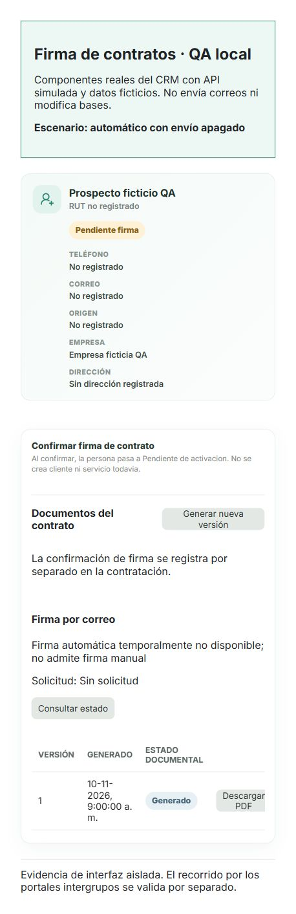
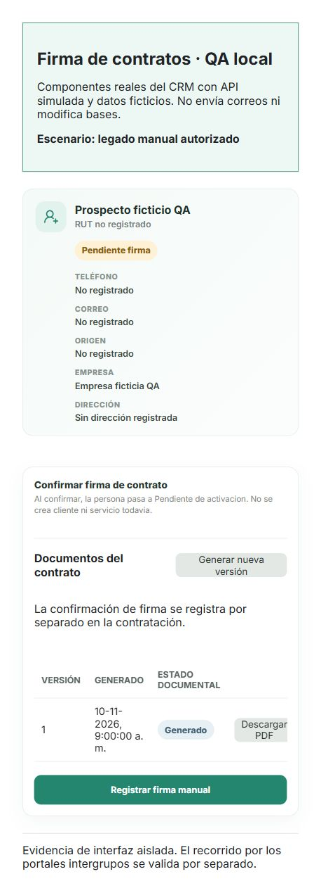
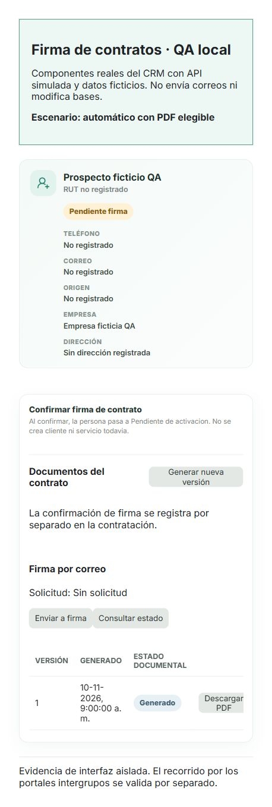
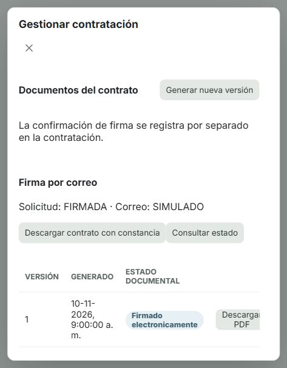

# Firma electrónica — segunda revisión local G8

Actualizado: 10 de noviembre de 2026. Estado: **correcciones verificadas; publicación de rama autorizada para revisión; aceptación integral pendiente**.

## Qué se entrega

La rama local es **fix/firma-prepr-privado-g8**, en el clon habitual:
C:\Users\lenovo\Desktop\Team_8---CRM.

- Base develop: 57789765550173b65a5777fd3d1d2ab4a2457b51.
- HEAD y versión publicada que se corrige: bfeb69a93f5eb661e9deb93d64d57b2d65b5c376.
- El usuario autorizó posteriormente el commit y la publicación de esta rama. El SHA publicado se consulta en Git; los metadatos de pruebas conservan el estado previo al commit.
- Esta entrega autoriza publicar solo la rama de corrección. No incluye PR, merge, despliegue, acceso a Railway ni cambios en la VPS.
- Se usa el mismo clon; no se creó otro repositorio ni worktree.
- La firma sigue apagada por defecto. No se cargaron archivos privados ni se enviaron correos reales.

El contenido revisable se identifica con el [manifiesto de código](manifest-codigo.json) y los parches:

- [Corrección desde la rama publicada](correccion-desde-bfeb69a.patch): cambios de esta revisión, incluidas las retiradas de la propuesta pública.
- [Candidato completo frente a develop](candidato-desde-develop.patch): funcionalidad de firma y corrección juntas.
- [Resumen del diff](diff-stat.txt): incluye los archivos nuevos sin staging.

Los parches excluyen esta carpeta de evidencia para evitar incluirse a sí mismos.
Las capturas, resultados y metadatos se entregan por separado.
Los archivos globales que aparecen como modificados frente a HEAD son reversiones de la propuesta anterior:
frente a develop, el canónico, Prisma, inventario de salud y verificador global **no tienen diferencias**.

## Cambios concretos

1. Se retiró la tabla pública propuesta y su migración Prisma. La evidencia reside en
   g8_contratos.solicitud_firma, con SQL parametrizado, referencias lógicas y la transacción del contrato.
2. Se separó la asignación automática de la disponibilidad del envío. Un contrato automático conserva ese modo
   aunque venza, falle el correo, se apague el servicio o se cambien las listas.
3. Ambas rutas manuales rechazan automático o modo desconocido. El legado requiere empresa y contrato autorizados explícitamente.
4. La UI oculta el botón manual, limpia un formulario abierto al cambiar de modo/ficha y consulta la política del servidor.
   Prospectos muestra documentos antes de existir cliente o servicio.
5. El envío también exige un PDF vigente/elegible; anular o sustituir una versión invalida su solicitud y OTP.
6. La fecha efectiva de Pendientes de activación usa evidencia electrónica o fecha manual existente, con desempate estable por ID.
   No escribe una fecha electrónica en fechaFirmaManual.
7. El PDF firmado se recupera con el envío apagado. Un rechazo SMTP confirmado admite recuperación autorizada;
   un resultado incierto no se reenvía automáticamente. La recuperación respeta empresa y permisos.
8. Se corrigió el entorno SMTP del workflow sin desactivar su barrera de loopback.
   La confirmación de firma mantiene los estados comerciales y no crea por sí sola OT, pago, inventario o servicio activo.

La asignación automática usa metadatos mínimos en la auditoría existente, sin evidencia personal, PDF, token u OTP.
La consulta autenticada de política puede registrar esa asignación bajo bloqueo.
La retención y recuperación de esa auditoría deben conservar esos eventos; no se agregó DDL compartido.

## Resultados reproducibles

Entorno temporal: Node 22.23.3 y PostgreSQL 15, bases exclusivas inicialmente vacías, credenciales efímeras,
datos ficticios y red externa bloqueada. La suite SMTP usa servidores de loopback; la firma usa correo simulado.

| Comprobación | Resultado |
| --- | --- |
| npm ci --ignore-scripts --no-audit --no-fund | PASS al preparar el contenedor, 904 paquetes; salida original no conservada |
| npm run prisma:generate | PASS |
| npm run build | PASS backend/frontend; aviso Vite de tamaño de bundle |
| npm test — backend | 93 suites, 1.764 pruebas PASS; 52 optativas omitidas |
| npm test — herramientas / runtime frontend / frontend | 38 / 3 / 158 pruebas PASS |
| Suite SMTP con entorno exacto del workflow | 43/43 PASS |
| npm run test:signature:postgres | 43/43 PASS, ejecutadas aparte de las omitidas |
| Pruebas nuevas de UI/política | 7/7 PASS |
| npm run db:audit:prisma-global | PASS, sin diferencias nuevas en el contrato compartido |
| node scripts/generate-health-contract.mjs | PASS; generado coincide con develop |
| git diff --check | PASS con la configuración de líneas del repositorio |
| Verificador global sobre PostgreSQL QA | PASS: 1.692 coincidencias, cero faltantes y diferencias |
| Arranque real sin esquema privado y firma apagada | PASS: AppModule inicia, HTTP /ready=200, legado manual una sola auditoría |
| Recuperación en proceso nuevo con envío apagado | PASS: 12 PDFs firmados persistidos y sus originales verifican sus huellas |

Las 52 omisiones no se contabilizan como éxitos. Incluyen suites de integración con activación explícita;
la de firma se ejecutó realmente en el ensayo PostgreSQL separado.
Las clasificaciones estáticas previas de Prisma/global siguen en su línea base: no se presentaron como reparadas por este cambio.
El workflow remoto de GitHub no se ejecutó porque esta corrección no está publicada.

Comando SMTP ejecutado desde la raíz, sin MAIL_PROVIDER heredado:

    node -r ./scripts/qa-loopback-only.cjs ./node_modules/jest/bin/jest.js --config backend/jest.config.js --runInBand --runTestsByPath backend/src/mail/mail.service.spec.ts

La regresión general propagó la barrera de loopback mediante NODE_OPTIONS y utilizó una URL inoperante para DATABASE_URL.
Los scripts PostgreSQL recibieron únicamente las URLs efímeras del clúster exclusivo; sus valores no se adjuntan.
[Resultados estructurados](resultados.json) · [Casos y resúmenes de ejecución](pruebas-resumen.txt).

## Catálogo y permisos

El canónico conserva 96 tablas, 982 columnas, 96 PK, 230 FK, 63 CHECK y 132 índices.

SHA-256 del canónico:
0472cdc09051404b5c3c41de30de02d9c8859eb212cb2c02b8307c160da70f50.

La instalación privada conserva exactamente el catálogo y permisos de public.
Los dos catálogos capturados tienen el mismo SHA-256:
37e21e8466ae0c6e3b8131c67a66b19eca4643653975b241913b91af0b54ed78.

[Antes](public-antes.json) · [Después](public-despues.json) · [Comparación](comparacion-public.json).
Son metadatos de la base ficticia, sin filas de negocio ni contraseñas.

El propietario QA fue qa_owner y el rol de ejecución qa_contract, distinto y no superusuario.
G8 tuvo USAGE y SELECT/INSERT/UPDATE; no CREATE ni DELETE.
Los tres roles de inicio de sesión simulados g1_app, g2_app y g3_app recibieron rechazo real 42501
al intentar SELECT, UPDATE e INSERT en el esquema privado.
No se comprobó ni cambió ningún rol de la VPS. Las pruebas no reemplazan su aprovisionamiento aprobado.

## Matriz de aceptación

| Caso | Estado y evidencia |
| --- | --- |
| Flag apagado sin esquema privado | PASS, proceso AppModule real + /ready + legado manual autorizado |
| Catálogo público y permisos intactos | PASS, catálogos antes/después y verificador global |
| G8 mínimo; G1/G2/G3 sin evidencia privada | PASS en roles reales del clúster QA exclusivo |
| Empresa excluida, ambas habilitadas, identidad compartida | PASS PostgreSQL; PDF excluido sin copia privada ni leyenda automática |
| Automático nunca manual / legado explícito | PASS UI, ambas entradas del servicio y PostgreSQL |
| PDF anulado, versión sustituida y snapshot cambiado | PASS; solicitud y OTP invalidados |
| Firma concurrente y carrera con anulación/nueva versión | PASS con dos conexiones; se cubrieron ambos órdenes del bloqueo |
| Fallo de estado/auditoría | PASS rollback de evidencia, estados y OTP |
| Fecha efectiva manual/electrónica/histórico sin fecha | PASS selección estable y conservación de campos |
| Documentos visibles desde Prospectos antes de instalar | PASS componentes reales con API simulada; PDF backend también probado en QA |
| PDF/constancia tras proceso nuevo, envío apagado o SMTP fallido/incierto | PASS persistencia e idempotencia; recuperación solo de rechazo confirmado |
| Contratos G1/G2/G3, pagos, Facturación.cl | Suites por componentes PASS; sin cambios de comportamiento de sus integraciones en este fix |
| Cadena única G2 → G8 firma → G3 cierre → una activación/asignación G1 | PENDIENTE, no se ha ejecutado como caso combinado en esta revisión |
| Recorrido visible por portales de cada grupo | PENDIENTE, requiere sus responsables/cuentas y ambiente aprobado |
| Revisión humana y controles remotos | PENDIENTE; CODEOWNERS continúa comentado y las protecciones reales no se configuraron |

## Capturas de interfaz

Son capturas del navegador de los **componentes reales del candidato con API simulada**.
No son capturas de la VPS, de los portales de otros grupos ni de una firma con datos reales.
El [fixture utilizado](interfaz-fixture.jsx) muestra explícitamente la sustitución de la API.
Los envíos y descargas del backend se acreditan con las pruebas separadas, no con esta simulación visual.

**1. Automático con envío apagado: no ofrece firma manual.**

**2. Legado manual autorizado explícitamente: ofrece Registrar firma manual.**

**3. Automático con PDF elegible: ofrece Enviar a firma y no firma manual.**

**4. Contrato firmado, envío apagado: conserva Descargar contrato con constancia.**
La captura muestra el contenido desplazado del modal de Clientes.

## Credenciales y alcance de la auditoría

No se abrieron, copiaron, modificaron ni empaquetaron los archivos privados.
Git solo registra las plantillas públicas; .env.smtp-private, .env.facturacion-private,
.env.facturacion-production-private y .env.railway siguen ignorados.

El escáner heurístico de la copia pública produjo 84 coincidencias incluyendo material heredado y ocho
hallazgos de un snapshot G1 previo. No se presentan esos ocho como una auditoría nueva de G1.
En las líneas añadidas por esta corrección, el único hallazgo fue una URL sintética de un test
que demuestra el rechazo de conexiones externas; su valor no se publica en el informe.
Los controles de higiene también verificaron plantillas, claves privadas completas y aislamiento del entorno.
No es una certificación de todo el historial remoto ni autoriza a compartir archivos privados.

[Revisión saneada](seguridad-saneada.json).

## Qué debe revisarse antes de publicar o activar

- G8 revisa los dos diffs, la política permanente, el repositorio privado y esta evidencia.
- Completar un caso combinado con simuladores G2/G8/G3/G1 y repetirlo en los portales del ambiente aprobado.
- Aprobar y aplicar por separado el esquema privado y los permisos efectivos de infraestructura.
  Ensayar respaldo/restauración y acordar retención de PDFs, OTP, consentimiento y asignación de política.
- Resolver las aprobaciones de identidad/consentimiento y las exigencias aplicables a nuevas contrataciones.
  El código por correo no sustituye el mecanismo admitido que falta acordar.
- Confirmar remitentes y HTTPS del ambiente y el procedimiento operativo para resultados SMTP inciertos.
- Configurar realmente los revisores/protecciones en GitHub si se quiere exigir esa revisión.

No se declara producción lista ni aceptación al 100 %. La publicación de la rama permite al equipo hacer la segunda revisión; no declara concluida la aceptación integral.

## Limpieza de la QA

Los dos contenedores exclusivos se eliminaron tras verificar sus etiquetas. Los nueve servicios locales anteriores permanecieron en ejecución.
El servidor temporal de capturas se detuvo y su carpeta temporal se eliminó. Las evidencias se conservaron en esta carpeta.
[Comprobación final](comprobacion-final.json) · [Limpieza del entorno](limpieza-qa.json).

## Autorización posterior a las pruebas

El 10 de noviembre de 2026 el usuario solicitó hacer commit y actualizar su rama. Se autoriza publicar únicamente fix/firma-prepr-privado-g8, sin PR ni merge.
La verificación previa confirmó que el código coincide con el ensayado. Solo se actualizó esta documentación para registrar la autorización.
Los archivos resultados.json y comprobacion-final.json son instantáneas anteriores al commit; sus campos de publicación describen ese momento, no el estado posterior de GitHub.
Los pendientes de portales, cadena combinada e infraestructura permanecen abiertos.
